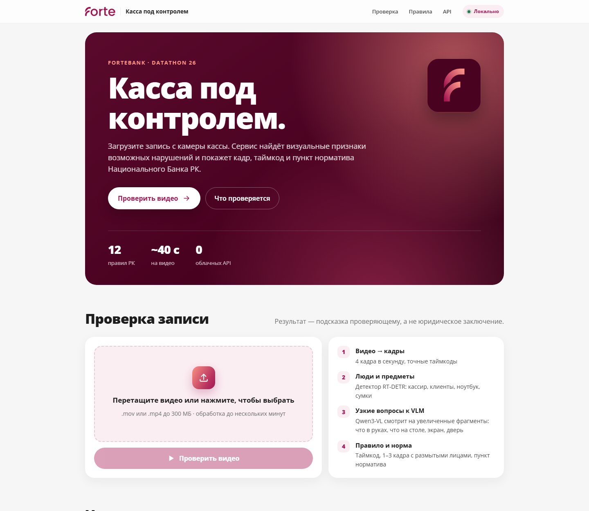
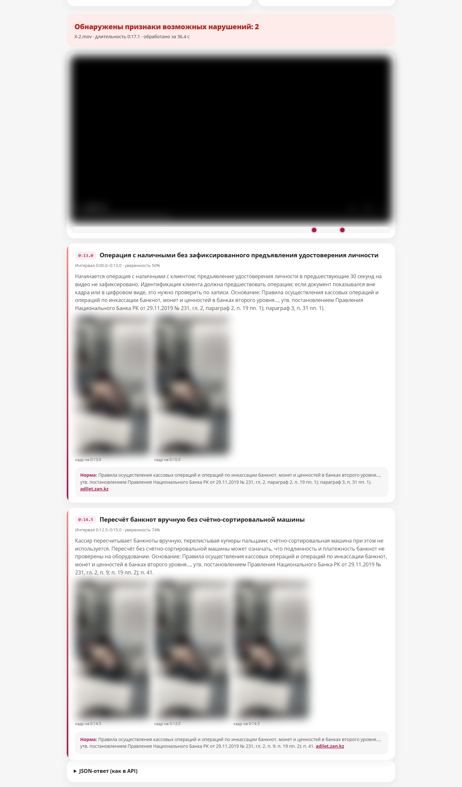
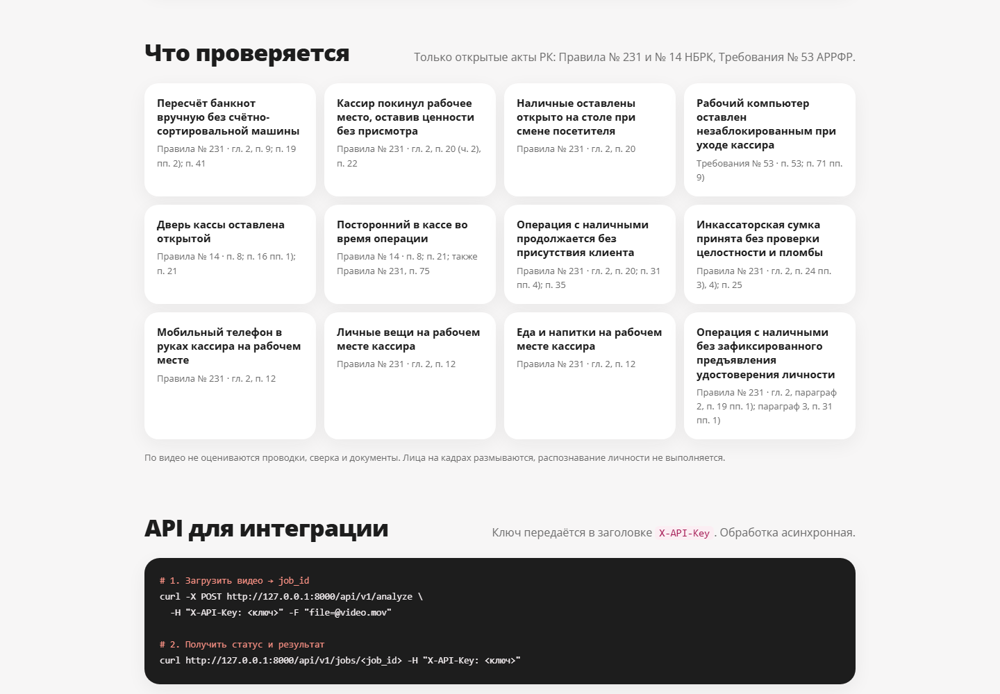

<div align="center">

# Касса под контролем

**Локальный AI-сервис, который смотрит запись с камеры кассы и показывает, где кассир, возможно, нарушил кассовую дисциплину: кадр, таймкод и пункт норматива РК.**

ForteBank · Datathon 26

[](pyproject.toml)
[](app/main.py)
[](app/pipeline/vlm.py)
[](app/pipeline/detect.py)
[](docs/architecture.md#локальность-и-переносимость)
[](docs/rules.md)
[](docs/architecture.md#производительность-rtx-5060-8-гб)

**[Открыть сервис → selection-gangway-alfalfa.ngrok-free.dev](https://selection-gangway-alfalfa.ngrok-free.dev)**

[Для жюри](#для-жюри) · [API](#api) · [Как это работает](#как-это-работает) · [Что ловит](#что-ловит) · [Результаты](#результаты) · [Запуск у себя](#запуск-у-себя)



</div>

Проверяющий загружает `.mov` и через 1–3 минуты получает вердикт: «нарушение не обнаружено» или «обнаружены признаки возможных нарушений». По каждому эпизоду сервис выдаёт тип, таймкод, описание увиденного, 1–3 кадра с размытыми лицами и ссылку на пункт норматива. Видео не покидает сервер: все модели работают локально, облачные AI-API не используются.

Результат — подсказка для человека, а не заключение. Проводки, сверку и подписи по видео сервис не оценивает.

## Для жюри

| | |
|---|---|
| Веб-интерфейс | https://selection-gangway-alfalfa.ngrok-free.dev |
| API base URL | https://selection-gangway-alfalfa.ngrok-free.dev |
| Ключ API | передан в форме сдачи, в репозитории его нет |
| Сервис доступен? | `GET /healthz` → `{"ok":true}` |

### В браузере

1. Откройте адрес. Бесплатный ngrok сначала покажет страницу «You are about to visit… served for free through ngrok.com». Нажмите **Visit Site**. В этом браузере она больше не появится.
2. В блоке «Проверка записи» перетащите видео в поле или нажмите на него и выберите файл (`.mov` или `.mp4`). Нажмите **«Проверить видео»**.
3. Подождите 1–3 минуты. На странице виден текущий этап.
4. Появятся вердикт, шкала видео с отметками и карточки нарушений: таймкод, описание, кадры, пункт норматива. Адрес страницы уже содержит `?job=<id>`, его можно сохранить и открыть позже.

### Через API

```bash
# 1. Отправить видео, получить job_id
curl -X POST https://selection-gangway-alfalfa.ngrok-free.dev/api/v1/analyze \
     -H "X-API-Key: <ключ>" -F "file=@video.mov"
# {"job_id":"3f2a9c1e0b7d","status":"processing"}

# 2. Опрашивать раз в 5–10 секунд, пока status = "processing"
curl https://selection-gangway-alfalfa.ngrok-free.dev/api/v1/jobs/3f2a9c1e0b7d \
     -H "X-API-Key: <ключ>"
```

Итог — `done` с вердиктом и нарушениями или `failed` с причиной. Без ключа или с неверным ключом — `401`. Формат ответа описан [ниже](#api).

Что важно знать:

- **Видео обрабатываются по одному**: видеокарта одна. Если отправить пять файлов сразу, остальные ждут в очереди со статусом `processing` и `stage: "queued"`. Одно видео занимает 1–3 минуты. Если лимит в 5 минут считается от загрузки, отправляйте следующее видео после `done` предыдущего.
- Скрипты (`curl`, Python `requests`/`httpx`) страницу ngrok не видят. Если клиент представляется браузером, добавьте заголовок `ngrok-skip-browser-warning: 1`.
- Сервер — компьютер команды с RTX 5060, опубликованный через ngrok со статическим доменом. Адрес не меняется.

## API

Два эндпоинта, ключ в заголовке `X-API-Key`.

| Запрос | Ответ |
|---|---|
| `POST /api/v1/analyze`, поле `file` | `{"job_id": "...", "status": "processing"}` |
| `GET /api/v1/jobs/{job_id}` | `processing` с этапом и прогрессом → `done` или `failed` |

```json
{
  "job_id": "3f2a9c1e0b7d",
  "status": "done",
  "verdict": "violation",
  "violations": [{
    "type": "Рабочий компьютер оставлен незаблокированным при уходе кассира",
    "timecode_sec": 19.5,
    "description": "Кассир покинул рабочее место, а экран рабочего компьютера остался разблокирован…",
    "evidence_frames": [{ "timestamp_sec": 19.5, "image_base64": "/9j/4AAQ…" }],
    "rule": { "document": "Требования… № 53", "clause": "п. 53; п. 71 пп. 9)", "url": "https://adilet.zan.kz/…" }
  }]
}
```

Схема совпадает с разделом 10 ТЗ. Поля `rule`, `interval_sec`, `confidence` и `detected_by` — дополнительные и обязательные поля не меняют.

<table>
<tr>
<td width="62%"></td>
<td></td>
</tr>
<tr>
<td>Результат проверки. Кадры на публичном скриншоте размыты (режим <code>?redact=1</code>): данные хакатона не публикуются.</td>
<td>Что проверяется и как подключить API.</td>
</tr>
</table>

## Как это работает

```
.mov ──► кадры 4 fps ──► RT-DETRv2: люди, ноутбук, сумки, посуда
                     ──► сцена: кассир (самый длинный трек), люди в кассе (люди за стеклом отсекаются
                          по размеру), вход / выход / касса опустела, момент ухода с рабочего места
                     ──► Qwen3-VL-4B на увеличенных фрагментах, только узкие вопросы:
                          · где счётная машина, сейф, дверь — один раз на видео
                          · что в руках кассира — каждые ~1,5 с, 3 кадра подряд
                          · при пересчёте: крупный план предмета (Swin2SR ×2) — купюры, удостоверение,
                            карта, телефон или документ; ушли ли деньги в машину
                          · при уходе кассира: экран ноутбука и что осталось на столе
                          · при входе людей: деньги на столе, кто подошёл к кассиру, не отражение ли это
                          · при приходе кассира: закрыта ли дверь
                     ──► ViTPose: кисти кассира у счётной машины до и после пересчёта
                     ──► временные правила ──► тип · таймкод · кадры · пункт норматива
```

На целом кадре 464×848 модель на 4 млрд параметров путается: может сказать «в комнате никого», когда там двое. На вырезанном фрагменте с одним вопросом она отвечает надёжно: экран ноутбука — 11 из 11 на эталонных кадрах. Поэтому детектор и наш код решают, куда и когда смотреть, а VLM — что там видно.

Два вспомогательных фильтра против ложных тревог по ручному пересчёту:

- **Деньги или нет.** Предмет в руках снимается крупным планом с повышением чёткости (Swin2SR ×2, ~0,27 с на фрагмент), и модель выбирает: купюры, удостоверение, карта, телефон или чехол, документ. Эпизод остаётся, только если хотя бы один из двух ответов — «купюры».
- **Руки у машины.** ViTPose находит кисти кассира. Если в 6 с после эпизода кисть у счётной машины в 3+ кадрах или в 4 с до него — в 10+ кадрах, это обычная обработка денег, а не пересчёт вручную.

Подробнее — в [docs/architecture.md](docs/architecture.md).

## Что ловит

| Нарушение | Что видно на записи | Норма |
|---|---|---|
| Пересчёт вручную без счётной машины | купюры в руках, кассир перелистывает их, в машину не уходят | Правила № 231, п. 9, 19 пп. 2), 41 |
| Ушёл, оставив ценности | кассир вышел, на столе деньги, сумка, планшет | № 231, п. 20, 22 |
| Деньги на столе при смене посетителя | входит следующий клиент, пачка лежит на столе | № 231, п. 20 |
| Компьютер не заблокирован | после ухода на экране рабочая программа, не экран блокировки | Требования АРРФР № 53, п. 53, 71 пп. 9) |
| Дверь кассы открыта | кассир вошла и не закрыла дверь | Правила № 14, п. 8, 16 пп. 1), 21 |
| Посторонний в зоне кассира | человек подходит к кассиру во время операции | № 14, п. 8, 21; № 231, п. 75 |
| Операция без клиента | клиент ушёл больше 5 с назад, а кассир продолжает работать с деньгами | № 231, п. 20, 31, 35 |
| Личные вещи, еда на рабочем месте | сумка, одежда, еда, напитки на столе | № 231, п. 12 |

Выключены после проверки на открытом наборе (включаются флагами в [analyze.py](app/pipeline/analyze.py)):

- телефон в руках — голубые купюры модель путала с телефоном;
- удостоверение до операции с деньгами (п. 19 пп. 1)) — 0 новых найденных нарушений при 5 ложных тревогах.

Источники и сопоставление пункта с кадром — в [docs/rules.md](docs/rules.md). Где норма пересказана, а не процитирована, это помечено. Где связь — толкование (еда, компьютер), в описании стоит «может указывать».

## Результаты

Прогон всех 40 уникальных видео открытого набора через HTTP API, как у жюри (`tools/eval.py --api`). Цифры предыдущей версии пайплайна, до ViTPose и Swin2SR. Прогон текущей версии остановлен на 16 видео из 40, чтобы не занимать GPU во время проверки жюри.

| Метрика | Значение |
|---|---|
| Точность вердикта | 65% (26/40) |
| Полнота — найдено видео с нарушением | 81% (17/21) |
| Ложные тревоги на «чистых» видео | 10 из 19 |
| Таймкод: медианная ошибка / в пределах 3 с | 4 с / 7 из 18 |
| Время обработки (текущая версия) | 50–80 с на видео 15–25 с; до ~3 мин на видео 60–140 с |

Пороги подбирались на этом же наборе, поэтому на новых видео цифры могут быть ниже. Больше всего ложных тревог дают два случая:

- законная работа с купюрами, например разбор после машины, похожая на пересчёт вручную;
- отражения людей в стеклянной стене, которые принимаются за постороннего. Проверка «не отражение ли это» на трёх таких видео отражения не отсекла.

Разбор — в [docs/limitations.md](docs/limitations.md).

## Запуск у себя

Windows, NVIDIA GPU от 8 ГБ:

```powershell
winget install astral-sh.uv Ollama.Ollama
uv sync                                  # Python 3.12, torch cu128, зависимости
ollama pull qwen3-vl:4b-instruct         # 3,3 ГБ, один раз; нужен именно *-instruct
uv run python -c "from huggingface_hub import snapshot_download as d; [d(m) for m in ('PekingU/rtdetr_v2_r50vd', 'caidas/swin2SR-classical-sr-x2-64', 'usyd-community/vitpose-base-simple')]"
.\serve.ps1                              # http://127.0.0.1:8000
.\tunnel.ps1 -Ngrok                      # в другом окне: публичный адрес (домен из NGROK_DOMAIN в .env)
```

Веса RT-DETRv2, Swin2SR и ViTPose скачиваются один раз (четвёртая строка): `serve.ps1` запускает сервис офлайн (`HF_HUB_OFFLINE=1`) и сам их не скачает. При первом запуске он создаёт `.env` со случайным `API_KEY`.

Linux или внутренний контур банка: `docker compose up -d`, шаги — в [docker-compose.yml](docker-compose.yml).

Свой прогон по размеченным видео:

```powershell
.\.venv-local\Scripts\python.exe tools\eval.py --api http://127.0.0.1:8000 --key <ключ> --tag mytest
.\tools\watch_eval.ps1 -Tag mytest                        # живой дашборд в терминале
python tools\rescore.py mytest --drop unauthorized_person   # пересчёт метрик без повторного прогона
```

## Документы

| | |
|---|---|
| [docs/submission.md](docs/submission.md) | что сдаём по разделу 8 ТЗ |
| [docs/architecture.md](docs/architecture.md) | компоненты, решения, производительность, план развития |
| [docs/violations.md](docs/violations.md) | типы нарушений по видео обучающего набора |
| [docs/rules.md](docs/rules.md) | нормативная база и сопоставление |
| [docs/limitations.md](docs/limitations.md) | ограничения и известные ошибки |

## Структура

```
app/
  main.py            FastAPI: /api/v1 (ключ), /ui (интерфейс), статика
  jobs.py            очередь задач, один GPU-воркер, результаты в runs/<job_id>/
  pipeline/          video · detect · scene · track · vlm · enhance (Swin2SR) · pose (ViTPose)
                     analyze · rules · report · faces
  static/            веб-интерфейс
tools/               eval, rescore, watch_eval, show_debug, contact_sheets, labels, probes
docs/                документация для сдачи
serve.ps1 · tunnel.ps1 · Dockerfile · docker-compose.yml
```

## Модели и лицензии

Все компоненты допускают коммерческое использование.

| Компонент | Модель | Лицензия |
|---|---|---|
| Детекция | RT-DETRv2 R50 (`PekingU/rtdetr_v2_r50vd`) | Apache-2.0 |
| Визуально-языковая модель | Qwen3-VL-4B-Instruct, Q4_K_M через Ollama | Apache-2.0 |
| Повышение чёткости фрагментов | Swin2SR classical ×2 (`caidas/swin2SR-classical-sr-x2-64`) | Apache-2.0 |
| Положение кистей рук | ViTPose base (`usyd-community/vitpose-base-simple`) | Apache-2.0 |
| Размытие лиц | YuNet (OpenCV Zoo) | MIT |
| Остальное | FastAPI, PyAV, OpenCV, transformers | MIT / BSD / Apache-2.0 |

Лица на кадрах-доказательствах размываются, распознавание личности не выполняется.
